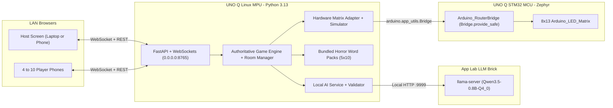

# The Last Clue

**An offline-capable, LAN multiplayer horror word game where your Arduino UNO Q becomes a haunted game master, uses local AI to create spooky rounds, and physically reacts to every game.**

## Feature Summary

- **4 to 10 Player LAN Social Deduction**: Players join via phone or laptop browser on the same Wi-Fi network by scanning a locally generated QR code. No cloud account, external API, or internet connection is required during play.
- **Strict Server-Authoritative Privacy**: Every Survivor receives the secret horror word privately on their device (with a hold-to-reveal shutter to prevent screen peeking). Exactly one Imposter receives only the horror category and must blend in. The secret word is never sent in public broadcasts or to the Imposter's browser.
- **Physical 8x13 LED Matrix Ghost**: The Arduino UNO Q's built-in 8x13 LED matrix renders 10 distinct non-blocking ghost expressions and animations (`Boot`, `Lobby`, `Roles Assigned`, `Clue Phase`, `Voting`, `Runoff`, `Imposter Discovered`, `Survivors Win`, `Imposter Wins`, `Idle`) over the `Arduino_RouterBridge`.
- **On-Board Open-Weight Local AI**: Configured via `app.yaml` to use Arduino App Lab's `arduino:llm` brick (`llamacpp:Qwen3.5-0.8B-Q4_0`) for atmospheric round introductions, phase narrations, and validated candidate word packs. Automatically falls back to 50 bundled horror words across 5 categories if local AI is unavailable or disabled.
- **Simulated Hardware Mode on macOS**: Includes an interactive 104-pixel (8x13) hardware visualizer and diagnostic panel on the Host Console for development and testing on macOS without a board attached.

---

## How the Game Is Played

1. **Lobby (`LOBBY`)**: Between 4 and 10 players join the room using their nickname. The Host can configure the horror category, discussion timer, voting timer, and local AI toggle.
2. **Secret Role Reveal (`ROLE_REVEAL`)**: The server selects a horror category and secret word, and assigns 1 Imposter using cryptographically secure randomness (`secrets.SystemRandom`). Players press and hold the shutter button to inspect their role card privately.
3. **Clue Round (`CLUE_ROUND`)**: Players speak in a randomized turn order. Each player submits one short clue (up to 40 characters) intended to prove they know the secret word without giving it away to the Imposter.
4. **Discussion (`DISCUSSION`)**: Once all clues are submitted, a server-authoritative countdown timer (default 60 seconds) begins so players can interrogate each other.
5. **Secret Voting & Tie Runoff (`VOTING` / `RUNOFF`)**: Each connected player casts one secret vote (self-votes are disallowed). If the top suspects tie, a single runoff ballot is held between the tied candidates. If the runoff remains tied, no one is caught and the Imposter escapes.
6. **Final Guess & Reveal (`FINAL_GUESS` / `RESULTS`)**:
   - If the group accuses an innocent Survivor (or ties the runoff), the Imposter escapes and wins immediately.
   - If the group catches the Imposter, the Imposter gets **one final guess** at the secret word (normalized for case, articles, and bundled synonyms).
   - **Scoring**: Each Survivor who voted for the caught Imposter earns **+1 point** when Survivors win. The Imposter earns **+2 points** when the Imposter wins (by escaping the vote or guessing the secret word).

---

## Architecture Diagram



---

## Repository Structure

```text
last-clue/
├── app.yaml                        # Arduino App Lab manifest (port 8765 + arduino:llm brick)
├── sketch/
│   ├── sketch.ino                  # STM32 8x13 LED matrix ghost renderer via Bridge.provide_safe
│   └── sketch.yaml                 # Zephyr platform + Arduino_RouterBridge (0.3.0) profile
├── python/
│   ├── main.py                     # Arduino App Lab Linux entry point
│   ├── requirements.txt            # Board runtime dependencies
│   ├── requirements-dev.txt        # Pytest + Ruff dev dependencies
│   └── last_clue/
│       ├── app.py                  # FastAPI + WebSocket + SPA static server
│       ├── config.py               # Environment settings loader
│       ├── game_engine.py          # Server-authoritative game state machine
│       ├── models.py               # Pydantic public/private schemas
│       ├── networking.py           # LAN IP discovery & SVG QR generator
│       ├── room_manager.py         # WebSocket session manager & rate limiter
│       ├── scoring.py              # Round scoring rules
│       ├── word_packs.py           # 5 horror categories x 10 words + synonym matching
│       ├── ai/                     # Local llama.cpp client, anti-leak validator, fallback
│       ├── hardware/               # 8x13 frame masks, UNO Q Bridge client, simulator
│       └── static/                 # Compiled production frontend assets
├── frontend/                       # Vite + React + TypeScript source
├── tests/                          # Automated unit & multi-client WebSocket test suite
└── scripts/
    ├── build.sh                    # Compiles frontend into python/last_clue/static/
    └── dev.sh                      # One-command local setup & startup
```

---

## Hardware and Software Requirements

- **Target Board**: Arduino UNO Q (Linux MPU running Debian with Python 3.13 + STM32 MCU running Zephyr with built-in 8x13 LED Matrix and Wi-Fi).
- **Development Machine**: macOS or Linux with Python 3.11+ and Node.js 20+.
- **Client Devices**: 4 to 10 smartphones or laptops on the same local Wi-Fi network with any modern mobile web browser.

---

## Quick Start on macOS (Simulated LED Matrix)

Run the entire application with a single command:

```bash
./scripts/dev.sh
```

Or run the individual steps manually:

```bash
# 1. Create Python environment and install dependencies
python3 -m venv --copies .venv
source .venv/bin/activate
pip install -r python/requirements-dev.txt

# 2. Build the production frontend into python/last_clue/static/
./scripts/build.sh

# 3. Run automated test suite
pytest

# 4. Start the production server on 0.0.0.0:8765
python python/main.py
```

For frontend hot-reload during UI development:

```bash
# Terminal 1: Start Python backend
.venv/bin/python python/main.py

# Terminal 2: Start Vite dev server on http://localhost:5173 (proxies /api and /ws to :8765)
cd frontend && npm run dev
```

---

## Deploying and Testing in Arduino App Lab IDE on Arduino UNO Q

### Step 1: Load and Start the App in Arduino App Lab IDE
1. Connect your Arduino UNO Q to the same Wi-Fi network as the phones you will use to play.
2. Open **Arduino App Lab IDE** and open this repository folder (`last-clue`).
3. Confirm App Lab detects `app.yaml` (publishing port `8765` and the `arduino:llm` brick `llamacpp:Qwen3.5-0.8B-Q4_0`), `python/main.py`, and `sketch/sketch.ino`.
4. Click **Run** in Arduino App Lab IDE:
   - App Lab compiles `sketch/sketch.ino` for `arduino:zephyr` and flashes the STM32 microcontroller.
   - App Lab installs `python/requirements.txt` and starts `python/main.py` on `0.0.0.0:8765`.
   - Check the App Lab console log for the printed `LAN Join URL` (e.g., `http://192.168.1.50:8765/?room=XXXXXX`) and `8x13 LED Matrix: UNO Q Router Bridge Connected`.

### Step 2: Verify the Physical 8x13 LED Matrix
1. On boot, watch the UNO Q's physical 8x13 LED matrix display the **Boot** ghost materialization animation followed by the **Idle / Lobby** floating ghost.
2. Open the Host Console in your browser (`http://<uno-q-ip>:8765`), click **Host a Game**, and join as Host.
3. In the right-hand **Arduino UNO Q 8x13 LED Matrix** panel, click through the 10 diagnostic buttons (`BOOT`, `LOBBY`, `ROLES ASSIGNED`, `CLUE PHASE`, `VOTING PHASE`, `RUNOFF`, `IMPOSTER DISCOVERED`, `SURVIVORS WIN`, `IMPOSTER WINS`, `IDLE`) to verify every sprite on the physical glass.

### Step 3: Verify On-Board Local AI (`Qwen3.5-0.8B-Q4_0`)
1. Inspect the AI status badge in the **Host Ritual Configuration** panel:
   - Model: `Qwen3.5-0.8B-Q4_0` (Apache-2.0 licensed open-weight model served locally via `llama-server` on `http://llamacpp-models-runner:9999/v1/chat/completions`).
   - *Hardware note*: The first request after booting the UNO Q can take 30 to 90 seconds while the quantized `.gguf` weights load into memory. If a request times out (`LAST_CLUE_LLM_TIMEOUT`, default `25s`), the game immediately uses the built-in horror packs and displays `AI UNAVAILABLE - USING BUILT-IN CONTENT`.
2. In **Host Ritual Configuration**, type a theme (e.g., `Haunted Relics`) and click **Summon AI Words** to test structured JSON generation and validation.
3. Check **Request fresh intro from on-board UNO Q LLM** before starting a round to generate a custom atmospheric introduction verified not to leak the secret word.

### Step 4: Full 4-Player Acceptance Test in App Lab
1. Scan the Lobby QR code from 3 phones (plus the Host browser = 4 players).
2. Click **Start Horror Round**.
3. On each device, hold **Hold to Peek Role**: verify 3 players see `SURVIVOR` + the secret word, and 1 player sees `IMPOSTER` + the category only.
4. Click **I Memorized My Role** on all 4 devices (or use the Host override) to enter the Clue Round.
5. Submit one short clue on each phone in the displayed turn order.
6. Discuss, then click **Open Secret Voting Now** on the Host screen.
7. Have all 3 Survivors vote for the Imposter:
   - Verify the UNO Q LED matrix switches to the angry **Imposter Discovered** ghost.
   - On the Imposter's phone, submit a final word guess to test both the **Imposter Wins** (correct word or synonym) and **Survivors Win** (wrong guess) outcomes.

---

## Word Pack Format and Customization

Bundled word packs live in `python/last_clue/word_packs.py` (`BUNDLED_WORD_PACKS`). Each entry uses `WordEntry`:

```python
WordEntry(
    word="Vampire",
    category="Horror Creatures",
    difficulty="easy",
    synonyms=["dracula", "nosferatu", "vampires"],
)
```

During the Imposter's final guess, `is_matching_guess` normalizes case, punctuation, leading articles (`the`, `a`, `an`), and accents (`séance` -> `seance`) and checks both `word` and `synonyms`.

---

## Troubleshooting & Network Notes

- **Port Already in Use**: Set `LAST_CLUE_PORT=8766` before running `python python/main.py` if port `8765` is occupied.
- **Phones Cannot Reach the UNO Q URL (Wi-Fi Client Isolation)**: Guest Wi-Fi networks, campus networks, and some routers enable AP/Client Isolation, which blocks peer-to-peer LAN traffic between wireless devices. If phones cannot load `http://<uno-q-ip>:8765`, connect the UNO Q and phones to a standard home router or a mobile hotspot without client isolation, and verify that macOS/Linux firewall settings allow incoming TCP connections on port `8765`.
- **Verification Status**: Automated unit tests, 4-client WebSocket integration tests, AI anti-leak/fallback tests, and `sketch.ino` sprite-mask parity checks were executed and verified on macOS (`16 passed`). Physical LED illumination and `arduino:llm` brick latency on the physical Arduino UNO Q hardware should be verified on-device using the Step 1-4 App Lab procedure above.

---

## Hackathon Demo Script (2 Minutes)

1. **Show the Hardware (20s)**: Point the camera at the Arduino UNO Q running The Last Clue in App Lab. Highlight the 8x13 LED matrix floating ghost and explain that the board hosts the FastAPI WebSocket server, the local LLM, and the physical LED ghost with zero cloud dependencies.
2. **Instant Phone Join (20s)**: Scan the Host screen QR code with a phone and join the lobby. Show the live player roster and trigger a quick LED matrix expression test from the Host panel.
3. **Secret Role Shutter (25s)**: Start the round. Demonstrate the tactile **Hold to Peek Role** shutter on a Survivor phone (showing the secret word) and on the Imposter phone (showing only the category).
4. **Clues, Accusation & Final Guess (40s)**: Submit rapid clues in turn order, advance to secret voting, convict the Imposter, watch the UNO Q LED matrix flash the angry **Imposter Discovered** ghost, and submit the dramatic final word guess.
5. **Results & Replay (15s)**: Show the full dossier breakdown, cumulative scoreboard, and victorious LED matrix animation.

---

## License

MIT License. See [LICENSE](LICENSE).
